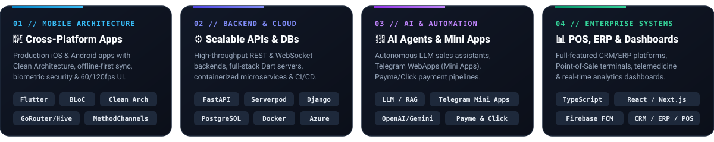
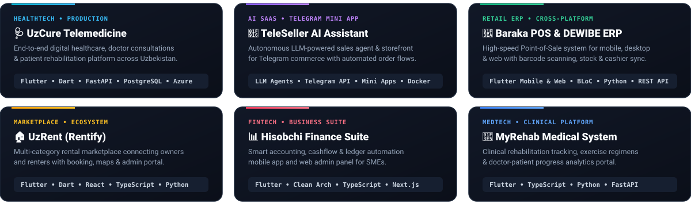
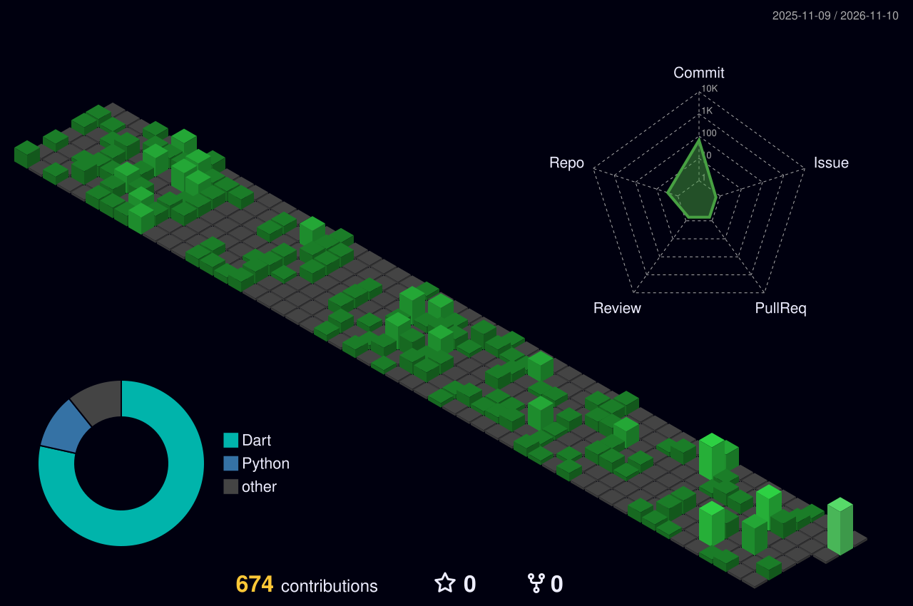

<!-- Self-Hosted Hero & Terminal Banner (100% Reliable, Zero External Camo Timeout) -->

  

<!-- Animated Typing Subtitle -->

<!-- Live Profile & Contact Badges -->

  
  
  
  
  

---

## 🧠 Engineering Architecture & Focus

I design, architect, and ship **end-to-end digital products**—from pixel-perfect **Flutter** mobile & desktop clients to high-concurrency **FastAPI / Django / Serverpod** backends and **AI-driven Telegram Mini Apps**. As a core engineer at **[DEWIBE IT Agency](https://github.com/dewibeuz)** in Tashkent, I turn complex business workflows into fast, reliable software.

  

- 🔭 **Currently shipping:** Enterprise POS/ERP systems (**Baraka POS**), Telemedicine platforms (**UzCure**), and AI commerce tools (**TeleSeller AI**)
- 📱 **Mobile Engineering:** `Flutter` • `Dart` • `BLoC / Cubit` • `Clean Architecture` • `GoRouter` • `GetIt / Injectable` • `Hive / Drift / Isar` • `Dio` • `MethodChannels`
- ⚙️ **Backend & Cloud:** `Python` • `FastAPI` • `Django REST Framework` • `Serverpod (Dart)` • `PostgreSQL` • `Firebase` • `Docker` • `Nginx` • `Microsoft Azure`
- 🤖 **AI & Automation:** `LLM Agents` • `OpenAI & Gemini APIs` • `Telegram Bots & WebApps (Mini Apps)` • `Payme & Click Payment Gateways`
- ⚡ **Philosophy:** *Clean architecture, offline-first resilience, and zero-compromise user experience.*

---

## 🚀 Flagship Production Systems Built @ [DEWIBE](https://github.com/dewibeuz)

> High-impact commercial products engineered and shipped for clients and internal SaaS ventures:

  

---

## 🧪 Featured Open-Source & Public Repositories

| Project | Architecture & Highlights | Tech Stack |
| :--- | :--- | :--- |
| 🥗 [**SlimWay**](https://github.com/flutterdevinmobile/slim_way) | **AI Diet, Calorie & Healthy-Living Ecosystem** — Personalized calorie/water goals, meal & workout tracking, analytics charts, and an integrated AI nutrition assistant. | `Flutter` `Serverpod` `Dart` `AI` |
| 🎓 [**Kursol**](https://github.com/flutterdevinmobile/kursol) | **Mobile E-Learning & Video Course Platform** — Custom HLS/MP4 video player, PDF reader, biometric authentication (`FaceID`/`TouchID`), offline caching & multi-language localization. | `Flutter` `BLoC` `Dio` `Hive` |
| 💳 [**Manage Money**](https://github.com/flutterdevinmobile/manage_money) | **Personal Finance, Debt & Expense Tracker** — Real-time cloud synchronization, Google Sign-In, interactive financial analytics charts, and multi-currency ledger. | `Flutter` `Firebase` `BLoC` `fl_chart` |
| 🍳 [**Magic Recipe AI**](https://github.com/flutterdevinmobile/magic_recipe_serverpod) | **Full-Stack Dart AI Recipe Generator** — Generates custom step-by-step culinary recipes from available ingredients using LLMs and a Serverpod backend. | `Flutter` `Serverpod` `LLM` `Dart` |
| 🔔 [**Firebase Notification Admin**](https://github.com/flutterdevinmobile/notif_admin_with_firebase) | **Real-Time Push Notification Control Center** — Web dashboard for managing FCM topics, targeted broadcasts, payload templates, and delivery metrics. | `TypeScript` `Firebase` `FCM` |
| 🏬 [**Kiyim-Kechak CRM & POS**](https://github.com/flutterdevinmobile/kiyim_kechak_bk) | **Wholesale Apparel CRM & Inventory Suite** — Full REST API backend ([`kiyim_kechak_bk`](https://github.com/flutterdevinmobile/kiyim_kechak_bk)) & web dashboard ([`kiyim_kechak_fr`](https://github.com/flutterdevinmobile/kiyim_kechak_fr)) for stock, sales, and supplier management. | `Django REST` `PostgreSQL` `React` |
| 📡 [**BI Smart Sensor**](https://github.com/flutterdevinmobile/BI_smart_sensor) | **IoT Telemetry & Business Intelligence Service** — Real-time smart sensor data ingestion, processing pipeline, and monitoring backend. | `Python` `IoT` `REST API` |

---

## 🛠 Tech Stack & Ecosystem

### 📱 Mobile & Cross-Platform Development

  

  
  
  
  
  
  
  

### ⚙️ Backend, Databases & Cloud Infrastructure

  

  
  
  
  
  
  
  

### 🌐 Frontend, AI & Developer Tooling

  

---

## 📊 GitHub Analytics & Performance

  
  

  

---

## 📈 3D Contribution Calendar

  <picture>
    <source media="(prefers-color-scheme: dark)" srcset="profile-3d-contrib/profile-night-green.svg" />
    <source media="(prefers-color-scheme: light)" srcset="profile-3d-contrib/profile-green.svg" />
    
  </picture>

---

## 🐍 Contribution Activity Snake

  <picture>
    <source media="(prefers-color-scheme: dark)" srcset="dist/github-snake-dark.svg" />
    <source media="(prefers-color-scheme: light)" srcset="dist/github-snake.svg" />
    
  </picture>

---

### 🤝 Let's Build Something Extraordinary Together

  

